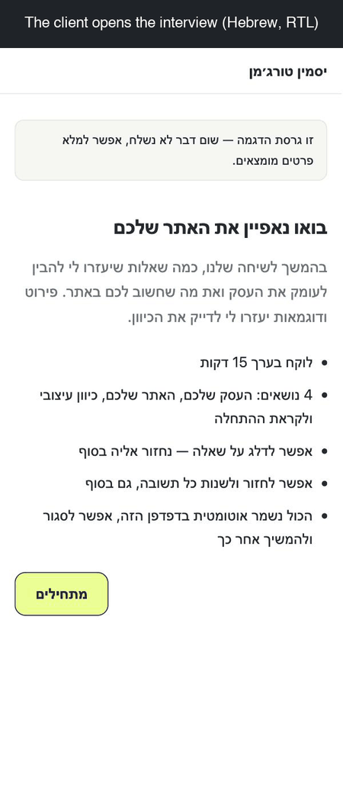
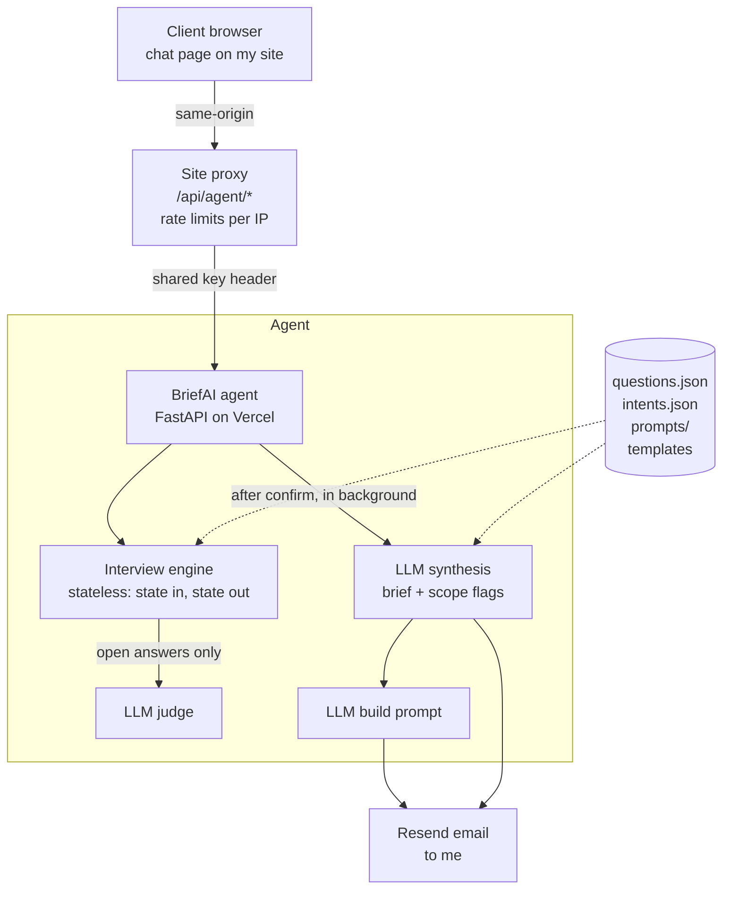

# BriefAI

An interview agent that turns a conversation with a new web-design client
into a structured design brief, a ready-to-use build prompt, and an email
in my inbox.

<p align="center">
  
</p>

_Demo run with a fictional client in demo mode (nothing is sent). The
interview is in Hebrew; captions explain each step._

## The business problem

I build websites for small businesses. To design a site that sets a
business apart, I need detail: concrete examples, what bothers the client
today, and what they want the site to do for them. A static questionnaire
takes whatever it gets, so a vague answer stays vague. Drawing out the real
answer, explaining why the detail matters, and then summarizing it all was
my job, and it's a lot of work.

BriefAI does that step. After the intro call, instead of filling in a form,
the client goes through an interview that asks follow-up questions when an
answer is incomplete, explains why a detailed answer helps, and turns the
conversation into a brief I can work from.

It's live on my site and still early, so there are no results to report
yet. The old form stays as a fallback.

## How it works

For the client, it's a chat of about 15 minutes, with buttons for quick
answers. Progress is saved in the browser, so they can close it and come
back later.

1. **Short form.** Name, business and contact details. These are required
   and never sent to the LLM for judgment.
2. **The interview.** 24 questions in 4 sections, taken verbatim from my
   existing questionnaire and stored as config (`questions.json`), not code.
   - **Choice questions** (buttons, multi-select, scales, colors) are
     answered with fixed inputs. Some answers trigger a pre-written follow-up
     (e.g. picking "appointment booking" asks what can be booked and whether
     they already use a booking system).
   - **Open questions** are asked conversationally. After each answer, an
     LLM "judge" checks it against a description of what a good answer
     looks like (`intents.json`). If the answer is vague, it asks one
     targeted follow-up, at most two per question.
   - Some questions appear only when an earlier answer makes them relevant.
3. **Client control.** Clients can skip any question (the agent comes back
   to skipped ones once at the end), say "don't know", or edit any earlier
   answer. Editing a choice answer re-evaluates which questions are relevant.
4. **Cost and length cap.** A configurable cap limits how many LLM-judged
   turns an interview can use, which keeps cost predictable. When it runs
   out, the remaining questions are still asked, just without follow-ups.
5. **Review.** The client sees all their answers and confirms or edits them.
6. **Brief.** One LLM call writes the internal brief, structured per
   `brief_template.md`: summary, scope flags, open items for the next call.
   The header and the full answers appendix are rendered by code, so the
   client's own words are never paraphrased.
7. **Build prompt.** A second LLM call turns the brief into a prompt I can
   paste into a coding agent to start the site. Fixed sections (ground
   rules, how to work, my standard requirements) are inserted verbatim by
   code.
8. **Delivery.** The brief, the build prompt and the full answers are
   emailed to me. If the brief fails, the raw answers are still sent: an
   interview is never lost to an LLM error. The client sees a summary of
   their own answers, built from the data without the LLM.

## Architecture



**No database.** The conversation lives in the client's browser and is
checked on every step, so no client data is stored on a server while the
interview is in progress.

**Stateless engine.** Every step takes the full interview state and returns
a new one. The server keeps nothing between requests: the browser holds the
state and sends it back each turn, HMAC-signed so it can't be tampered with
(e.g. to reset the cost cap). That removes the need for a database and
makes serverless deployment simple.

**Config over code.** Questions, what a good answer looks like, fixed
follow-ups, prompts, templates and UI text are all JSON/Markdown files. The
same engine could run a different interview without code changes.

The site proxy and chat page live in my website's repo. This repo holds the
agent, a local copy of the chat UI (`web/`), and a CLI.

## Where the LLM is used and where it isn't

| Step | LLM? | Why |
|---|---|---|
| Judging open answers for specificity | **Yes** | Needs language understanding; returns structured JSON (`specific`, `follow_up`) |
| Explaining a question when the client asks "what does this mean?" | **Yes**, only after a cheap pre-check (short question-like replies) | Avoids an LLM call on every reply |
| Writing the brief and the build prompt | **Yes** | Synthesis across all answers |
| Form fields, choice questions, fixed follow-ups | No | Deterministic input; nothing to judge |
| Question order, conditional questions, skips, edits, cost cap | No | Flow is a fixed loop the code controls, not an agent deciding what to do |
| Answers appendix, contact header, client's view of their answers | No | Facts are rendered from the data so they're never paraphrased or invented |
| Ground rules and standards inside the build prompt | No | Inserted verbatim from the template |
| Bot checks (honeypot, minimum fill time) | No | A flagged interview runs with no LLM calls and sends nothing |

The judge, the explainer and the brief return structured output (Pydantic
schemas); the build prompt is free text. Every call has capped output tokens.

## Running it

Requires Python 3.13+ and [uv](https://docs.astral.sh/uv/).

```bash
cp .env.example .env      # add your OpenAI key and model names
uv sync
uv run python -m briefai                       # interview in the terminal
uv run uvicorn briefai.web:app --port 8765     # web chat at http://localhost:8765
uv run pytest                                  # 52 tests, no API calls
```

Locally, interviews and briefs are saved to `transcripts/` (gitignored).
Email is optional: it's sent only when the Resend variables are set. Engine
settings (cost cap, follow-up limits, token caps) are in `settings.json`.

All client-facing text is in Hebrew (right-to-left), since my clients are
Hebrew-speaking. Code, prompts and docs are in English.

## Stack

- Python 3.13, uv
- FastAPI, Pydantic
- OpenAI Responses API with structured outputs (model names come from `.env`)
- Resend for email
- Vanilla JavaScript and CSS for the chat UI (no framework)
- Vercel (serverless Python), with a Node proxy on the main site
- pytest

Built with Claude Code, working from a project spec file that set the
build order: CLI first, then synthesis, web UI, email, and site
integration, each step tested before the next.

## What I'd improve next

- **Stronger cost controls for a public link.** Today the link goes only
  to clients I've spoken with, behind per-IP rate limits and a hard spend
  limit on the API key. Before publishing it openly, I'd add an overall
  daily cap and a per-interview limit on LLM calls.
- **An evaluation set.** Simulated clients (vague, terse, detailed) run
  through the interview automatically, to tune the judge and the cost
  cap with data rather than by hand.
- **Quote agent.** The brief already outputs scope flags as structured
  fields, so a second agent could combine them with my price list and
  draft a quote.
- **Pre-filling from intro-call notes,** so the interview skips what I
  already know.

## License

All rights reserved. The code is published so it can be read and evaluated.
See [LICENSE](LICENSE).
